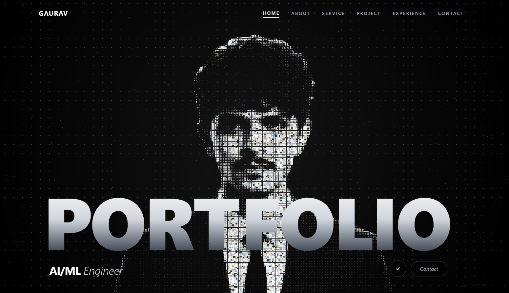

# Gaurav Patel — AI/ML Engineer Portfolio Workspace

This workspace houses the complete reconstruction, enhancement, and personalization of the **Code & Chill** showcase portfolio, tailored to the credentials of **Gaurav Patel** (AI/ML Engineer).

---

## Workspace Navigation

- **Portfolio Application:** [`app/`](app/)
  - Complete React 18 + Vite + Tailwind + WebGL2 codebase.
  - See [`app/README.md`](app/README.md) for quick-start commands and architectural breakdown.

---

<p align="center">
  
</p>

## About Me — Gaurav Patel

> **AI/ML Engineer** specializing in Generative AI, Large Language Models (LLMs), RAG Architectures, and Production Full-Stack Systems.

- 📍 **Location:** Ahmedabad, Gujarat, India
- 🎓 **Education:** B.Tech in Computer Science Engineering — Indus University (Expected May 2027)
- 💼 **Current Role:** AI Intern at Ativeg Technologies
- 🌐 **GitHub:** [github.com/gauravpatel007](https://github.com/gauravpatel007)
- 💼 **LinkedIn:** [linkedin.com/in/gaurav-patel-7a7586378](https://www.linkedin.com/in/gaurav-patel-7a7586378)
- ✉️ **Email:** [gaurav.patel.1008.2006@gmail.com](mailto:gaurav.patel.1008.2006@gmail.com)


### AI/ML & Core Engineering
---
- **Generative AI & LLMs:** LangChain, LangGraph, RAG Pipelines, Vector Databases (Chroma/FAISS), Reranking, Ollama, Hugging Face, Conversational AI Agents
- **Deep Learning & NLP:** PyTorch, TensorFlow, Scikit-learn, Neural Networks, spaCy, TF-IDF, Word Embeddings
- **Languages & Frameworks:** Python, JavaScript (ES6+), FastAPI, Node.js
- **Data Science & Tools:** Pandas, NumPy, Matplotlib, Seaborn, Docker, Git, GitHub, PostgreSQL


### Featured Projects
---
- **LifeOS — AI Healthcare Platform** *(In Development)*
  - Comprehensive AI healthcare platform unifying symptom analysis, medical record comprehension, personalized fitness/nutrition guidance, and medication management.
  - Integrated Generative AI, NLP, and intelligent recommendation systems.
  - [GitHub Repository](https://github.com/gauravpatel007/Healthcare-Ai-Mobile)
- **AI Resume Intelligence** *(Completed)*
  - Full-stack resume screening platform with spaCy NLP extraction (NER & skill matching), TF-IDF job role prediction, weighted 100-point candidate ranking, and PDF export.
  - [GitHub Repository](https://github.com/gauravpatel007/Ai-Resume-Intelligence)
- **RAG-Based Study Assistant** *(Completed)*
  - Privacy-first, locally hosted semantic document Q&A assistant built with Ollama, local LLMs, and sentence embeddings for zero-API-cost document comprehension.
  - [GitHub Repository](https://github.com/gauravpatel007/RAG-Based-Study-assistant)

### Experience & Milestones
---
- **AI Intern** — Ativeg Technologies *(Jul 2026 – Present)*
  - Developing NLP and AI/ML solutions with a focus on Generative AI, LangChain, RAG architectures, and agentic workflows.
- **AI Intern** — Indus University *(Jun 2024 – Jul 2024)*
  - Hands-on machine learning, deep learning fundamentals, and neural network modeling.
- **Final Round Finalist** — *Odoo x Indus University Hackathon 2026*
- **Certificate of Appreciation** — *AI Internship, Indus University (2024)*

---

## Quick Commands

```bash
# Navigate to portfolio application
cd app

# Install dependencies
npm install

# Run local development server (http://localhost:5000)
npm run dev

# Run automated functional regression tests (35 assertions)
npm test

# Build production bundle
npm run build
```


## 🛠️ Technology Stack

### Portfolio Web Application
| Layer | Technologies | Highlights |
| :--- | :--- | :--- |
| **Frontend Framework** | [React 18](https://react.dev/) | Modular component architecture, state hooks, and dynamic route/view handling |
| **Bundler & Build Tool** | [Vite 6](https://vitejs.dev/) | High-speed ESM dev server with Hot Module Replacement (HMR) and optimized rollup builds |
| **Styling & Theming** | [Tailwind CSS 3.4](https://tailwindcss.com/) | Mobile-first responsive design, dark mode aesthetic, and custom utility classes |
| **Motion & Kinetics** | [GSAP 3.12](https://greensock.com/gsap/) + ScrollTrigger | Scroll-scrubbed kinetic typography, matrix cypher reveals, and pinned carousels |
| **Graphics & Shaders** | WebGL2 & HTML5 Canvas | Custom GLSL particle photomosaic shader and 60FPS Breakout arcade mini-game |
| **Icons & UI Assets** | [Lucide React](https://lucide.dev/) | Accessible, modern vector icon set |
